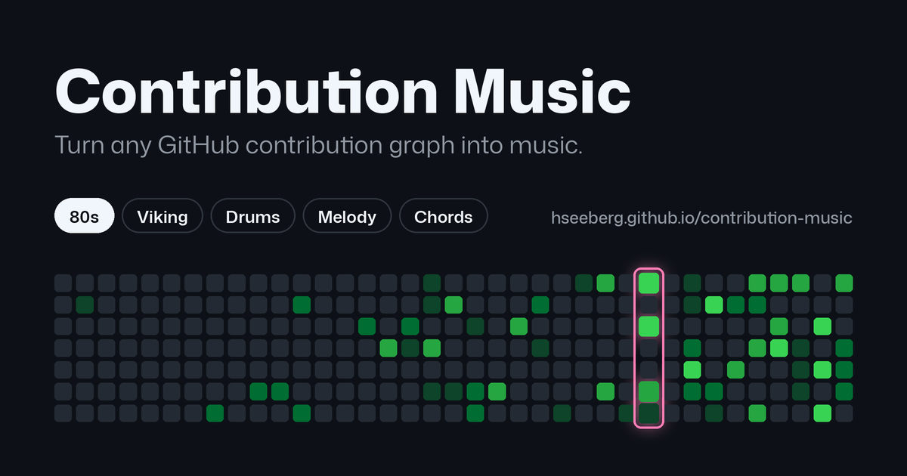

# Contribution Music

Turn any GitHub contribution graph into music.

- **Play it:** https://hseeberg.github.io/contribution-music/
- **Source code:** https://github.com/hseeberg/contribution-music
- **Open a user directly:** `https://hseeberg.github.io/contribution-music/#USERNAME`

## How to use

1. Enter a GitHub username and select **Load graph**.
2. Choose a style.
3. Choose how many times to play: **Once**, **3 times** or **Loop**.
4. Select **Play**. A pink frame shows which square is playing.

## Styles

All styles except Drums and Chords read each week from top to bottom. In most of them, the number of active days in a week picks the chord.

| Style | Tempo | What you hear |
|---|---|---|
| **80s** | 110 BPM | Drum machine with gated snare, pulsing bass, lead synth with echo. Chords: Am, F, C, G. |
| **90s Techno** | 140 BPM | Kick on every beat, offbeat bass and open hi-hats, supersaw stabs. Chords: Am, Dm, F, G. |
| **Drum & Bass** | 174 BPM | Fast breakbeat, deep sub bass, electric piano. Chords: Am7, Dm7, Fmaj7, Em7. |
| **Hip-hop** | 88 BPM | Swung boom bap beat, round bass, vibraphone. Chords: Am9, Dm9, Fmaj7, E7. |
| **Rap** | 140 BPM | Half-time trap beat, heavy 808 bass, rolling hi-hats, bell melody. Chords: Am, F, Dm, E. |
| **Viking** | 110 BPM | Frame drum, lyre and a low drone in D minor pentatonic. |
| **Drums** | 110 BPM | Read left to right. Each row is one drum. |
| **Melody** | 110 BPM | Each week is one 7-beat bar. Week activity picks the scale. A Sunday thump marks each bar. |
| **Chords** | 110 BPM | Read left to right. Each column is one chord. |

Each style keeps its own tempo. Change it with the **Tempo** slider.

## Choose what plays

- **Play range:** drag the two handles under the graph to choose the first and last week. Arrow keys, Page Up/Down and Home/End also work.
- **Skip long silences:** a run of empty weeks becomes one bar of rest.
- **Trim empty start and end:** on by default. Playback starts at the first active week and ends at the last one. Turn it off to play every week.
- **Time range:** since the first contribution, or the last 12 months.

## Privacy

This page does not collect, keep or sell your data.

**When you load a graph**

- You type a GitHub username. The page sends this username to [github-contributions-api](https://github.com/grubersjoe/github-contributions-api).
- This service is not part of this page. Another person operates it. It reads public contribution data from GitHub.
- The service sends back the number of contributions for each day. The page uses these numbers only to show the graph and to make sound.
- The page does not keep the username or the numbers. When you close the page, they are gone.

**What the page does not do**

- It does not use cookies.
- It does not use analytics or tracking.
- It does not save data on your device.
- It sends the username only to the contribution service. It sends no other data.
- It does not use your microphone or camera.

**Sound**

- Your browser makes all sound on your device. No audio leaves your device.

**Services that you connect to**

- GitHub Pages hosts this page. GitHub can record your IP address when the page loads. Read the [GitHub Privacy Statement](https://docs.github.com/en/site-policy/privacy-policies/github-general-privacy-statement).
- The contribution service can record your IP address and the username that you type. We do not control this service.
- All fonts and files load from this website. The page does not load files from other websites.

**Good to know**

- The page shows public contributions only. Private contributions show only if the account owner turns them on in GitHub.
- A link such as `…/#octocat` keeps the username in your browser history. Your browser does not send this part of the link to a server.

**Questions:** open an [issue](https://github.com/hseeberg/contribution-music/issues).

## How it works

- Static files only: `index.html`, `og.png` and the `fonts/` folder. No build step, no server.
- All sound is made in the browser with the Web Audio API.
- If a username does not exist, the field says so. If the data service is down, the page keeps the last graph or shows a sample, and the button changes to **Try again**.

## Credits

- Font: [Mona Sans](https://github.com/github/mona-sans) by GitHub, SIL Open Font License 1.1. See `fonts/LICENSE.txt`.
- Data: [github-contributions-api](https://github.com/grubersjoe/github-contributions-api) by grubersjoe.

## Good to know

- No sound on iPhone? Turn off silent mode.
